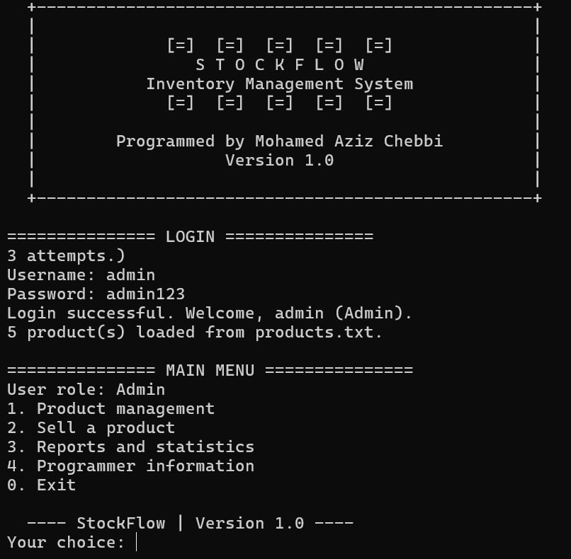
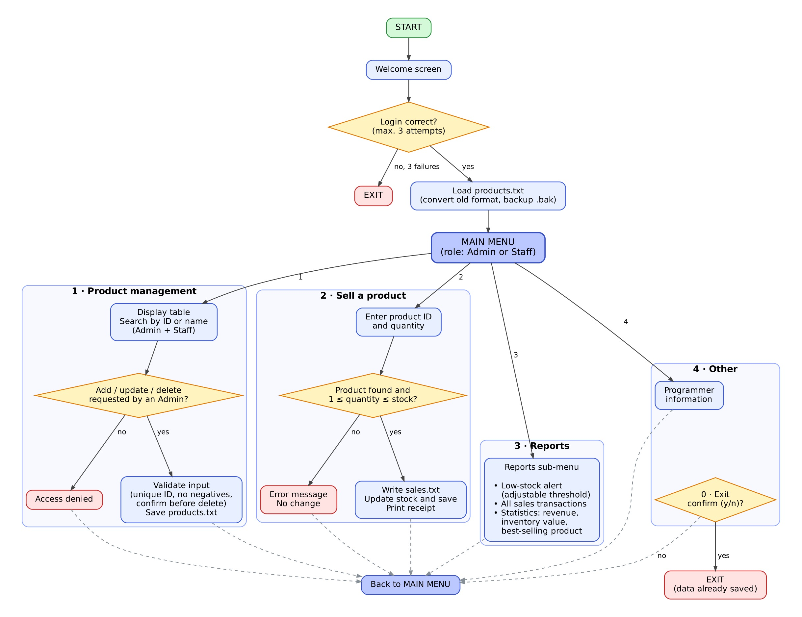

# StockFlow — Inventory Management System (C++)



A **console-based Inventory Management System** built using C++.
This project simulates a real-world inventory system used in small stores or warehouses.

---

## Features

- Login System (Admin / Staff roles, 3 attempts)
- Add, Update and Delete Products (Admin only)
- View Inventory Table
- Search Product by ID or Name
- Sell Product (stock deduction + receipt with date and time)
- Low Stock Alert (adjustable threshold)
- Sales Report and Statistics (revenue, inventory value, best seller)
- Input Validation (duplicate IDs, negative values, invalid quantities)
- File-Based Data Storage
- Menu-Driven Interface

---

## Screenshots

### Login and Main Menu


### Inventory Table


---

## System Flowchart

The following diagram shows the logical flow of the system including login authentication, inventory operations, and sales processing.



---

## Technologies Used

- C++ Programming Language
- Classes and Objects (`Product`, `Inventory`)
- Arrays
- File Handling (fstream)
- Console UI
- Basic Authentication Logic

---

## System Architecture

User

↓

Console Interface (`main.cpp`)

↓

Inventory Logic (`Product`, `Inventory`, `Utils`)

↓

File Storage

**Data Files Used**

`products.txt` — stores product inventory

`sales.txt` — stores sales transactions

---

## Product Data Format

Each product is stored in this format:

`ID|Name|Category|Stock|Price`

Example:

```
101|Laptop|Computers|12|899.99
102|Mouse|Accessories|40|14.50
103|Keyboard|Accessories|3|29.90
```

---

## Sales Data Format

Each sale record contains:

`Date|ProductID|ProductName|Quantity|UnitPrice|TotalPrice`

Example:

```
2026-10-17 21:40:20|103|Keyboard|2|29.90|59.80
2026-10-17 21:40:20|102|Mouse|1|14.50|14.50
```

---

## Login Credentials

| Role | Username | Password |
|---|---|---|
| Admin | `admin` | `admin123` |
| Staff | `staff` | `staff123` |

Demo accounts only: not secure enough for a real system.

---

## Example Menu

```
1. Product management
2. Sell a product
3. Reports and statistics
4. Programmer information
0. Exit
```

---

## How to Run

```bash
g++ -std=c++11 -o stockflow main.cpp Product.cpp Inventory.cpp Utils.cpp
./stockflow
```

Run it from the folder that contains `products.txt` and `sales.txt`.

---

## Learning Objectives

This project demonstrates:

• Object-oriented design (classes, getters and setters)

• Array storage in memory

• File persistence using text files

• Inventory management logic

• Input validation

• Menu-driven program design

• Basic authentication with roles

---

## Project Structure

```
StockFlow/
├── main.cpp
├── Product.h / Product.cpp
├── Inventory.h / Inventory.cpp
├── Utils.h / Utils.cpp
├── products.txt
├── sales.txt
├── README.md
└── screenshots/
    ├── img1.jpg
    └── img2.jpg
```

---


## Author

**Mohamed Aziz Chebbi**

Computer Science Student
